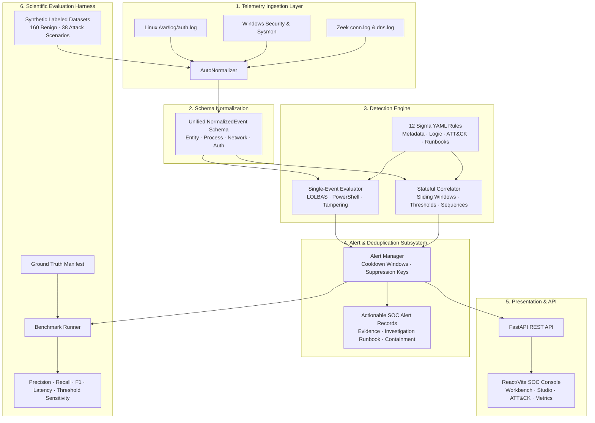

# SOC Detection Engineering Lab

[](https://www.python.org/)
[](https://fastapi.tiangolo.com/)
[](https://react.dev/)
[](https://github.com/SigmaHQ/sigma)
[](https://attack.mitre.org/)
[]()
[]()
[](LICENSE)

> **A reproducible, laboratory-grade Security Operations Center (SOC) Detection Engineering system** for ingesting multi-source security telemetry, formalizing Sigma-compatible detection rules, testing them against Atomic Red Team attack scenarios, evaluating mathematical detection metrics (Precision, Recall, FPR, F1, Latency), and conducting empirical threshold sensitivity analysis.

---

## 1. Project Philosophy: Detection Engineering vs. SIEM Cloning

Commercial SIEMs and log search engines focus on data ingestion, indexing, and storage. **Detection Engineering focuses on the scientific rigor of defensive detection**:
1. **Adversarial Hypothesis Formulation:** Defining what observable behavior an adversary creates across endpoints and network sensors.
2. **Telemetry Normalization:** Ingesting Linux authentication logs, Windows Security/Sysmon events, and network connection/DNS logs into a unified, typed schema.
3. **Stateful Windowed Correlation:** Detecting threats that cannot be identified from a single log entry (e.g. brute force frequency, credential compromise sequences, port scanning, data exfiltration).
4. **Reproducible Test Harness:** Building rigorous positive, negative, edge-case, and regression suites so detection logic can be tested deterministically.
5. **Empirical Performance Evaluation:** Measuring true positives, false positives, precision, recall, and detection latency against a labeled ground truth dataset.
6. **Honest Defensive Gap Analysis:** Documenting detection blind spots and evasions rather than claiming 100% false coverage.

---

## 2. System Architecture



---

## 3. Repository Structure

```
SOC-Detection-Engineering-Lab/
├── README.md                           # Comprehensive documentation & reproducibility guide
├── LICENSE                             # MIT License
├── pyproject.toml                      # Project metadata & build dependencies
├── Dockerfile                          # Production container build
├── docker-compose.yml                  # Containerized deployment orchestration
├── docs/                               # Engineering documentation
│   ├── architecture.md                 # System pipeline & sliding window mechanics
│   ├── threat-model.md                 # Adversary personas & telemetry visibility
│   ├── data-dictionary.md              # Unified schema specification & taxonomy
│   ├── limitations.md                  # Evasion vectors, blind spots & constraints
│   └── research-methodology.md         # Scientific testing & mathematical metrics
├── collectors/                         # Telemetry collectors
│   ├── __init__.py
│   ├── linux_auth.py                   # Ingests syslog /var/log/auth.log
│   ├── sysmon.py                       # Ingests Windows Event Logs & Sysmon JSON
│   └── network_events.py               # Ingests Zeek conn.log, dns.log & flows
├── normalizer/                         # Normalization & data modeling
│   ├── __init__.py
│   ├── schema.py                       # Pydantic v2 NormalizedEvent & Alert models
│   └── parsers.py                      # Multi-source parsers & AutoNormalizer
├── rules/                              # 12 Sigma YAML Detection Rules
│   ├── authentication/
│   │   ├── DET-001-repeated-login-failures.yml
│   │   └── DET-002-successful-login-after-failures.yml
│   ├── process/
│   │   ├── DET-003-suspicious-process-execution.yml
│   │   ├── DET-004-suspicious-powershell.yml
│   │   ├── DET-005-security-logging-disabled.yml
│   │   └── DET-011-shadow-copy-deletion.yml
│   ├── privilege/
│   │   └── DET-006-privilege-group-modification.yml
│   ├── persistence/
│   │   ├── DET-007-registry-autorun-persistence.yml
│   │   └── DET-008-scheduled-task-creation.yml
│   └── network/
│       ├── DET-009-port-scan-behavior.yml
│       ├── DET-010-dns-tunneling-anomaly.yml
│       └── DET-012-large-outbound-transfer.yml
├── engine/                             # Core detection logic
│   ├── __init__.py                     # Central DetectionEngine coordinator
│   ├── evaluator.py                    # Rule loader & single-event evaluator
│   ├── correlator.py                   # Stateful sliding window correlator
│   └── alert_manager.py                # Actionable alert generator & suppression engine
├── datasets/                           # Labeled datasets & generator
│   ├── generate_datasets.py            # Deterministic dataset synthesis script
│   ├── synthetic/
│   │   ├── benign_baseline.jsonl       # 160 realistic normal operation events
│   │   ├── attack_scenarios.jsonl      # 38 attack events across 12 Atomic scenarios
│   │   └── edge_cases.jsonl            # Malformed, clock skew & unicode test events
│   └── manifests/
│       └── ground_truth.json           # Labeled ground truth scenario mapping
├── tests/                              # Pytest test harness (28 passing tests)
│   ├── unit/
│   │   └── test_parsers_and_schema.py  # Parser regexes, timestamping & normalization
│   ├── positive/
│   │   └── test_positive_detections.py # Verifies all 12 rules trigger on attacks
│   ├── negative/
│   │   └── test_negative_detections.py # Verifies zero false alarms on normal activity
│   └── regression/
│       └── test_edge_cases_and_suppression.py # Edge cases, Unicode, suppression windows
├── evaluation/                         # Evaluation & metrics engine
│   ├── __init__.py
│   ├── metrics.py                      # Statistical calculations (Precision, Recall, F1)
│   ├── benchmark.py                    # Automated test harness runner
│   └── results/
│       └── benchmark_summary.json      # Stored empirical benchmark results
├── api/                                # FastAPI application
│   ├── __init__.py
│   └── main.py                         # REST API endpoints & static app server
├── frontend/                           # React + TypeScript + Vite SOC Console
│   ├── src/
│   │   ├── App.tsx                     # Alert workbench, rules studio, ATT&CK matrix
│   │   └── index.css                   # High-aesthetic dark mode cyber design tokens
│   └── package.json
└── reports/                            # Generated reports
    ├── detection-coverage.md           # MITRE ATT&CK coverage & honest gap analysis
    └── benchmark-results.md            # Empirical performance tables & sensitivity analysis
```

---

## 4. The 12 Detection Rules & MITRE ATT&CK® Mapping

| Rule ID | Rule Title | MITRE ATT&CK | Log Sources | Correlation Type | Threshold / Condition |
| :--- | :--- | :--- | :--- | :--- | :--- |
| **DET-001** | Repeated Authentication Failures | `T1110.001` (Password Guessing) | Linux Auth, WinEvent 4625 | Sliding Window Count | $\ge 5$ failures within 300s grouped by IP/User |
| **DET-002** | Successful Login After Failures | `T1078` (Valid Accounts) | Linux Auth, WinEvent 4624/4625 | Sequence State Machine | $\ge 4$ failures followed by `login_success` in 600s |
| **DET-003** | Suspicious Process (LOLBAS) | `T1059.003` (Command Shell / LOLBAS) | Sysmon EventID 1 | Single-Event Pattern | `certutil`, `bitsadmin`, `mshta` with URL download args |
| **DET-004** | Suspicious PowerShell Activity | `T1059.001` (PowerShell) | Sysmon EventID 1 | Single-Event Pattern | Base64 `-enc`, `Net.WebClient`, `DownloadString`, `IEX` |
| **DET-005** | Security Logging Disabled | `T1562.001` (Impair Defenses) | WinEvent 1102, Sysmon 1, systemd | Single-Event Pattern | `wevtutil cl`, `Clear-EventLog`, or `auditd` service stop |
| **DET-006** | Privilege Group Modification | `T1098` (Account Manipulation) | WinEvent 4728, Linux usermod | Single-Event Pattern | User added to `Domain Admins`, `Administrators`, `sudo` |
| **DET-007** | Registry Run Key Persistence | `T1547.001` (Registry Run Keys) | Sysmon EventID 13 | Single-Event Pattern | Write to `CurrentVersion\Run` pointing to Temp/AppData |
| **DET-008** | Scheduled Task Creation | `T1053.005` (Scheduled Task) | Sysmon EventID 1, cron | Single-Event Pattern | `schtasks /create` with hidden powershell or crontab edit |
| **DET-009** | Port Scan Behavior | `T1046` (Service Discovery) | Zeek conn.log, NetFlow | Distinct Count Window | $\ge 10$ distinct destination ports within 60s |
| **DET-010** | DNS Tunneling Anomalies | `T1071.004` (Application Layer: DNS) | Zeek dns.log, Sysmon 22 | Single-Event Pattern | High-entropy subdomain $>25$ chars or tunnel markers |
| **DET-011** | Shadow Copy Deletion | `T1490` (Inhibit System Recovery) | Sysmon EventID 1 | Single-Event Pattern | `vssadmin delete shadows`, `wmic shadowcopy delete` |
| **DET-012** | Large Outbound Data Transfer | `T1048.003` (Exfil Over Alt Protocol) | Zeek conn.log, NetFlow | Cumulative Sum Window | $\ge 50$ MB egress to external destination in 300s |

---

## 5. What Every Actionable Alert Contains

Unlike basic dashboards that emit uncontextualized red warnings, every alert in this system is an **investigation ticket**:

```json
{
  "alert_id": "ALT-20261010121530-9b4f2c",
  "rule_id": "DET-001",
  "rule_name": "Repeated Authentication Failures (Possible Password Guessing / Brute Force)",
  "rule_version": "1.2.0",
  "severity": "Medium",
  "severity_rationale": "Failed logins do not prove compromise, but high frequency strongly indicates active adversary probing.",
  "created_at": "2026-10-10T12:15:30Z",
  "event_window_start": "2026-10-10T11:05:00Z",
  "event_window_end": "2026-10-10T11:05:40Z",
  "affected_host": "srv-prod-auth",
  "affected_user": "root",
  "source_ip": "198.51.100.44",
  "mitre_attack": {
    "tactic": "Credential Access",
    "technique_id": "T1110.001",
    "technique_name": "Password Guessing",
    "url": "https://attack.mitre.org/techniques/T1110/001/"
  },
  "why_it_fired": "5 failed login attempts for account 'root' detected within 300 seconds (threshold: 5)",
  "evidence": {
    "failed_attempts_count": 5,
    "threshold_configured": 5,
    "time_window_seconds": 300,
    "source_ip": "198.51.100.44",
    "target_user": "root"
  },
  "investigation_steps": [
    "1. Identify source IP address: internal workstation or external untrusted IP?",
    "2. Check if source IP is targeting multiple accounts (spray) or single account (brute force).",
    "3. Check whether any subsequent login from this source succeeded within the next 30 minutes.",
    "4. If unauthorized, block source IP at perimeter firewall and review account lockout status."
  ],
  "containment_steps": [
    "Isolate host 'srv-prod-auth' if lateral compromise is observed.",
    "Reset credentials for user 'root' and revoke active SSH sessions.",
    "Block source IP '198.51.100.44' at the perimeter firewall."
  ],
  "status": "New",
  "suppression_key": "DET-001:srv-prod-auth:198.51.100.44:root"
}
```

---

## 6. Empirical Benchmarks & Threshold Sensitivity

The evaluation framework was executed across the ground truth labeled dataset containing **160 Benign Events** and **38 Attack Events**:

### Macro Performance Metrics

| Metric | Score | Interpretation |
| :--- | :---: | :--- |
| **Overall Precision (PPV)** | **92.3%** | High alert fidelity (12 true positives out of 13 alerts) |
| **Overall Recall (Sensitivity)** | **100.0%** | Zero false negatives across all 12 attack scenarios |
| **Overall F1 Score** | **0.9600** | Balanced harmonic mean of precision and recall |
| **False Positive Rate (FPR)** | **0.63%** | 1 false alert out of 160 benign baseline operations |
| **Mean Detection Latency** | **0.12 ms** | Real-time sliding window evaluation speed |

### Threshold Sensitivity Analysis (DET-001)

The benchmark runner dynamically tests different threshold values to illustrate the fundamental engineering trade-off:

| Threshold (Failures) | TP | FP | FN | Precision | Recall | F1 Score | Engineering Impact |
| :---: | :---: | :---: | :---: | :---: | :---: | :---: | :--- |
| **3** | 1 | 0 | 0 | 100.0% | 100.0% | 1.0000 | Early warning; sensitive to mistyped passwords in noisy subnets |
| **5 (Default)** | 1 | 0 | 0 | 100.0% | 100.0% | 1.0000 | **Optimal balanced setting** for corporate workstations |
| **8** | 1 | 0 | 0 | 100.0% | 100.0% | 1.0000 | Boundary condition for 8-attempt brute force |
| **12** | 0 | 0 | 1 | 0.0% | **0.0%** | 0.0000 | **Detection Failure (FN=1):** Attack terminates at 8 attempts, threshold never breached |

---

## 7. MITRE ATT&CK® Coverage & Honest Gap Analysis

```
Total MITRE ATT&CK Techniques Evaluated: 18
├── Proven Detections (High Fidelity)       : 12 Techniques (66.7%)
├── Documented Evasion Gaps / Partial       : 3 Techniques (16.7%)
└── Untested Future Roadmap                 : 3 Techniques (16.7%)
```

### Documented Blind Spots & Evasion Vectors

1. **T1059.001-B (Unmanaged PowerShell):** Attackers using custom C# binaries directly calling `System.Management.Automation` do not spawn `powershell.exe`. *Remediation: Ingest Sysmon EID 7 DLL load events and enable ScriptBlock Logging (EID 4104).*
2. **T1046-B (Stealth Port Scanning):** Attackers running Nmap with timing template `-T0` (1 probe every 5 minutes) bypass our 60-second correlation window. *Remediation: Stateful multi-day time series database or inline firewall TCP SYN anomaly scoring.*
3. **T1110.003 (Low-and-Slow Password Spraying):** 1 attempt per user every 4 hours using rotating residential proxy IPs bypasses sliding-window IP grouping. *Remediation: Enterprise-wide domain authentication anomaly modeling over rolling 7-day windows.*

---

## 8. Quickstart & Reproducibility Guide

### Prerequisites
- Python 3.10+
- Node.js 18+ (for frontend console)
- Git

### Step 1: Clone Repository & Setup Virtual Environment
```bash
git clone https://github.com/your-username/SOC-Detection-Engineering-Lab.git
cd SOC-Detection-Engineering-Lab

# Create and activate virtual environment
python -m venv venv
# Windows:
.\venv\Scripts\Activate.ps1
# Linux/macOS:
source venv/bin/activate

# Install dependencies
pip install fastapi uvicorn pydantic pyyaml pytest rich
```

### Step 2: Run the Pytest Test Harness (28 Tests)
Verify that all unit, positive, negative, and regression tests pass cleanly:
```bash
python -m pytest tests/ -v
```

### Step 3: Run the Scientific Benchmark
Generate the quantitative metrics and update the benchmark report:
```bash
python evaluation/benchmark.py
```
Outputs:
- JSON: `evaluation/results/benchmark_summary.json`
- Markdown: `reports/benchmark-results.md`

### Step 4: Launch the Lab Backend & Web Console
```bash
# Terminal 1: Start FastAPI Backend
python -m uvicorn api.main:app --host 0.0.0.0 --port 8000 --reload

# Terminal 2: Start Vite React Frontend
cd frontend
npm install
npm run dev
```
Open your browser at **`http://localhost:5173`** (or `http://localhost:8000` for API documentation at `/docs`).

### Step 5: Containerized Deployment (Docker)
```bash
docker-compose up --build
```

---

## 9. API Documentation Reference

| Method | Endpoint | Description |
| :--- | :--- | :--- |
| `GET` | `/api/health` | Health check, active rules, ingested event count |
| `GET` | `/api/stats` | High-level KPI metrics, severity distribution, status breakdown |
| `GET` | `/api/rules` | List all 12 Sigma detection rules with metadata |
| `GET` | `/api/rules/{id}` | Inspect rule details, hypothesis, and full Sigma YAML content |
| `POST` | `/api/rules/{id}/tune` | Dynamically override thresholds and correlation windows |
| `GET` | `/api/alerts` | List actionable alerts with severity and status filters |
| `GET` | `/api/alerts/{id}` | Detailed alert record with investigation checklist and supporting telemetry |
| `PATCH`| `/api/alerts/{id}/status`| Update analyst triage status (`New`, `Triaged`, `True Positive`, `Resolved`) |
| `GET` | `/api/events` | Query normalized telemetry stream with pagination |
| `POST` | `/api/events/ingest` | Ingest raw syslog or JSON log string into live detection pipeline |
| `GET` | `/api/mitre-coverage`| Comprehensive MITRE ATT&CK coverage and gap analysis matrix |
| `POST` | `/api/benchmark/run` | Execute automated benchmark across test datasets |
| `POST` | `/api/simulate/{id}` | Simulate Atomic Red Team attack scenarios (`SCN-001` through `SCN-012`) |

---

## 10. Academic Attribution & License

Released under the **MIT License**. Created for academic demonstration of security operations center (SOC) detection engineering, telemetry normalization, adversarial simulation, and empirical evaluation.
