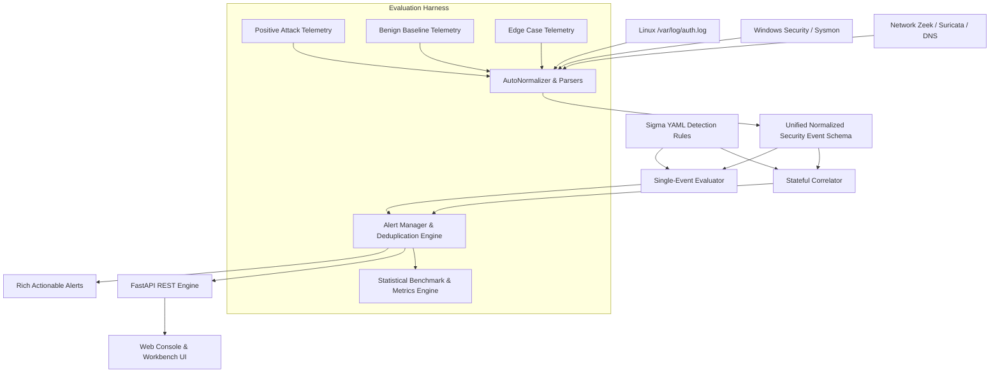

# SOC Detection Engineering Lab: System Architecture

## 1. Architectural Overview

The SOC Detection Engineering Lab is designed as an end-to-end telemetry ingestion, normalization, rule evaluation, sliding-window correlation, and alert generation pipeline. It prioritizes reproducible testing and quantitative metric measurement over black-box SIEM storage.

---

## 2. Pipeline Subsystems

### A. Telemetry Ingestion & Collection Layer (`collectors/`)
- **`linux_auth.py`**: Ingests Linux authentication and syslog streams (`/var/log/auth.log`), matching SSH session activity, sudo executions, and PAM authentication events.
- **`sysmon.py`**: Ingests Windows Event Logs and Sysmon telemetry (Event ID 1: Process Creation, Event ID 3: Network Connection, Event ID 13: Registry Modification, Event ID 4624/4625: Logon Success/Failure, Event ID 4728: Group Membership Changes, Event ID 1102: Audit Log Cleared).
- **`network_events.py`**: Ingests network sensor logs (Zeek `conn.log` and `dns.log`, Suricata EVE JSON, firewall flow summaries).

### B. Normalization Layer (`normalizer/`)
Converts heterogeneous raw logs into the `NormalizedEvent` schema based on Pydantic v2:
- Standardized entity identification: `host`, `user`, `target_user`, `target_group`.
- Standardized network endpoints: `source_ip`, `source_port`, `dest_ip`, `dest_port`, `protocol`.
- Process hierarchy: `process_name`, `process_path`, `command_line`, `parent_process_name`.
- Network & payload metadata: `bytes_out`, `bytes_in`, `dns_query_name`.

### C. Rule Specification Layer (`rules/`)
Detection rules are maintained in portable, documented YAML format inspired by Sigma:
- Stored across modular directories: `authentication/`, `process/`, `privilege/`, `persistence/`, `network/`.
- Every rule defines detection hypothesis, required log sources, tunable thresholds, suppression parameters, MITRE ATT&CK mapping, known false positives, and investigator runbooks.

### D. Detection Engine (`engine/`)
- **`evaluator.py`**: Evaluates single-event rules (process execution, LOLBAS abuse, PowerShell flags, defense evasion commands, privilege additions, registry modifications).
- **`correlator.py`**: Maintains sliding time-window state buffers:
  - *Threshold Aggregation*: Sliding-window failure frequency (e.g., $\ge 5$ failed logins within 300s).
  - *Sequence Detection*: State machine recognizing bursts of failures followed by successful authentication.
  - *Distinct Port Counting*: Fast discovery of horizontal and vertical port scanning.
  - *Cumulative Summation*: Sliding window egress byte accumulation for data exfiltration detection.
- **`alert_manager.py`**: Generates rich `Alert` objects with investigation checklists, containment playbooks, and deduplication/suppression windows.

### E. Evaluation & Benchmarking Subsystem (`evaluation/`)
- Automated benchmark runner computes Confusion Matrices, Precision, Recall, False Positive Rate (FPR), F1 Score, and Detection Latency.
- Dynamic threshold sensitivity analysis models the trade-off curve between early detection and false alert fatigue.
